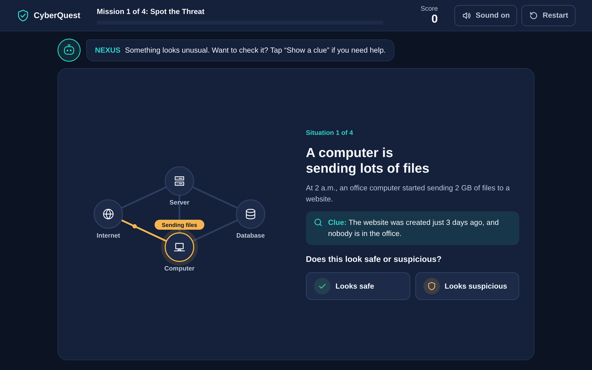
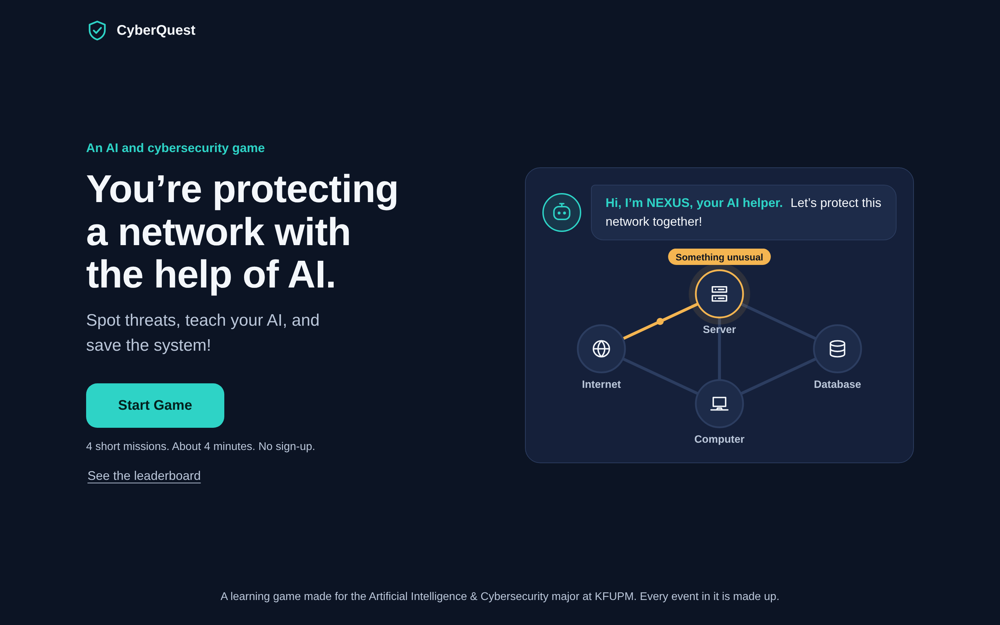
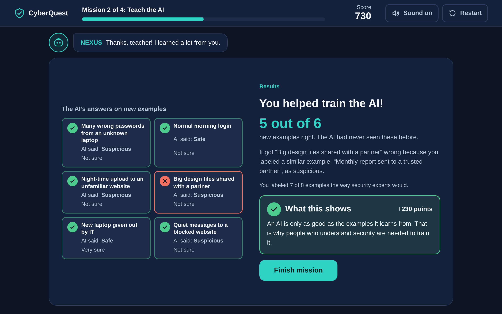
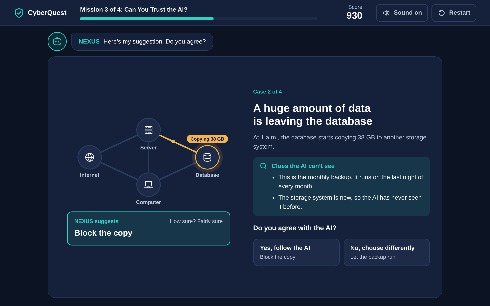
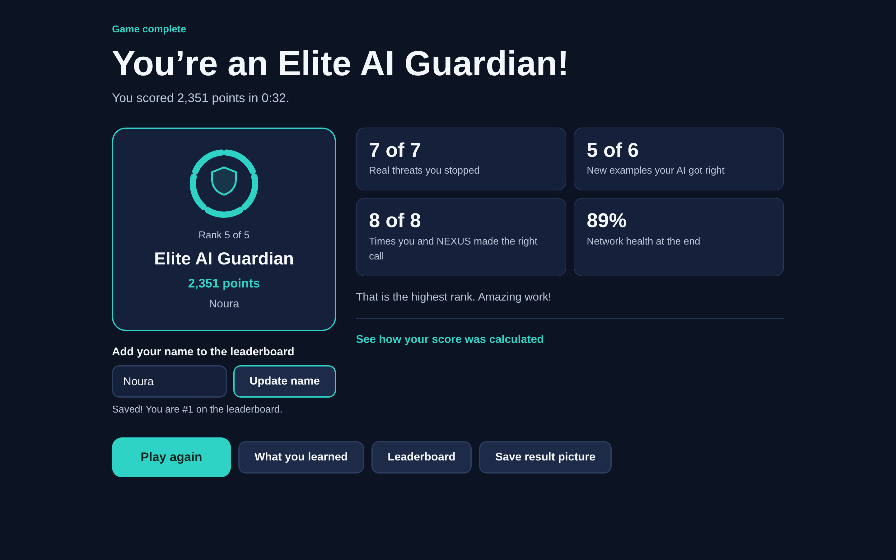

# CyberQuest

**A short, beginner-friendly game about AI and cybersecurity.** Players protect a network with the help of an AI assistant: they spot threats, teach an AI, decide when to trust it, and save the network from an attack. It takes about four minutes and needs no technical background.

CyberQuest was made as an exhibition game for the **Artificial Intelligence & Cybersecurity** major at King Fahd University of Petroleum & Minerals (KFUPM). It is a student project and is not an official university product.



---

## Contents

1. [Why it exists](#why-it-exists)
2. [What players learn](#what-players-learn)
3. [Screenshots](#screenshots)
4. [How it plays](#how-it-plays)
5. [Design principles](#design-principles)
6. [How the AI works](#how-the-ai-works)
7. [Technology and structure](#technology-and-structure)
8. [Running it](#running-it)
9. [Deploying to GitHub Pages](#deploying-to-github-pages)
10. [Scoring](#scoring)
11. [Leaderboard limitations](#leaderboard-limitations)
12. [Testing](#testing)
13. [Future improvements](#future-improvements)

---

## Why it exists

Most booth visitors are freshmen and prospective students. They have never studied cybersecurity or machine learning, and they have a few minutes at most. CyberQuest gives them a quick, hands-on taste of the field so they leave thinking: *I didn't realise AI and cybersecurity could be this exciting.*

## What players learn

- Cybersecurity protects computers, accounts and information.
- AI can help spot unusual activity.
- AI learns from examples, and bad examples teach it bad lessons.
- AI makes mistakes: sometimes a false alarm, sometimes a missed attack.
- People and AI make better security decisions together.

## Screenshots

These are real captures of the game (taken during a scripted test run).

| Start screen | Mission 2: the AI's results after training |
| --- | --- |
|  |  |

| Mission 3: do you agree with the AI? | Results |
| --- | --- |
|  |  |

## How it plays

Every screen has one task: a short title, one or two sentences, one picture, and two or three big buttons. After each choice the player sees right away whether it was a good call, a one- or two-sentence explanation, and a Continue button.

| | Mission | What the player does |
| --- | --- | --- |
| 1 | **Spot the Threat** | Four situations, one at a time (a night-time upload, a phishing email, an IT safety check, an approved website update). Decide *Looks safe* or *Looks suspicious*. A clue is one tap away. Two of the four are safe, which shows that unusual does not always mean dangerous. |
| 2 | **Teach the AI** | Label eight examples as *Safe* or *Suspicious*, one at a time. Press *Train the AI*. The AI then answers six new examples it has never seen, and the game explains any mistakes in plain words, for example: "It got this wrong because you labeled a similar example as safe." |
| 3 | **Can You Trust the AI?** | NEXUS suggests what to do and says how sure it is. The player reads the clues NEXUS can't see and answers *Yes, follow the AI* or *No, choose differently*. NEXUS is wrong in two of the four cases. |
| 4 | **Save the Network** | Four urgent problems with a 60-second clock and a network health bar. Real threats drain health every second until they are handled. One problem is just an employee who forgot their password, because not everything is an attack. NEXUS's suggestion is wrong on the last one. |

**NEXUS**, the AI helper, appears as a friendly guide above the game. Its messages stay short (usually under 25 words), and it offers a hint if a player seems stuck for 20 seconds.

## Design principles

- **One screen, one task, one decision.** No alert queues, logs, dashboards or competing panels.
- **Plain English.** No unexplained jargon. When a concept matters (phishing, ransomware), it is named and explained in one sentence.
- **Readable at a booth.** Arial throughout, 18px body text, nothing below 16px, large buttons, high contrast. Text scales up on large 1080p screens.
- **Fits the screen.** Every gameplay screen fits without scrolling at 1366×768, 1440×900 and 1920×1080. Phones get a scrolling single-column layout.
- **Simple visuals.** The network is four recognisable devices (Internet, Server, Computer, Database). The device involved lights up; the picture supports the story and is never a puzzle.
- **Calm colour.** Dark navy, white text, one teal accent. Green, amber and red appear only to show results and danger.

## How the AI works

CyberQuest has two kinds of AI, and the game says which is which.

### NEXUS: a simulated, rule-based assistant

NEXUS is **not** a language model and is not connected to anything. It is a set of about twenty hand-written rules in `js/ai-engine.js`. Each situation has hidden *telemetry* (wrong-password counts, how much data is moving compared with normal, whether it is night, whether a website is known). Each rule that fires adds or subtracts points, giving a 0–100 score that becomes a suggestion and a "How sure?" level.

NEXUS can only see telemetry, never the clues the player sees (calendars, approvals, HR records). That is the realistic reason it gets some cases wrong:

- it wants to block the approved monthly backup (a false alarm),
- it trusts a login that an attacker tricked the employee into approving (a missed attack),
- it treats files leaking to a famous cloud website as normal (a missed attack).

These mistakes come out of the rules themselves, and the test suite checks that they happen.

### The trainable AI: a real k-nearest-neighbours classifier

Mission 2 uses genuine machine learning, written in plain JavaScript:

- Each example is described by five numbers: wrong passwords, unusual time, risky website, amount of data and new device.
- The model learns **only from the player's labels**. The correct answers are used afterwards to tell the player how they did, never for training.
- It uses *k*-nearest neighbours with *k* = 3: a new example gets the label most common among the three most similar examples the player labeled.
- It is tested on six separate examples that are never used for training. "Very sure" means all three neighbours agreed; "Not sure" means they split 2 to 1.

With correct labels the AI gets 6 out of 6. Mislabeling a single example such as the huge upload to a brand-new website costs two answers. Labeling everything as safe drops it to 3 out of 6.

## Technology and structure

HTML, CSS and plain JavaScript. **No frameworks, build step, backend, API keys or external requests.** It runs as static files and also works when `index.html` is opened directly from disk.

```text
CyberQuest/
├── index.html            Start, play and results screens
├── css/
│   ├── style.css         Colours, type sizes, screen layouts, screen-size rules
│   ├── components.css    Buttons, choices, clues, feedback, network picture, results
│   └── animations.css    Small motion cues, reduced-motion support
├── js/
│   ├── scenarios.js      All player-facing text and situation data
│   ├── ai-engine.js      NEXUS rules and the k-nearest-neighbours classifier
│   ├── game.js           Game state, scoring ledger, ranks, timers (no DOM)
│   ├── leaderboard.js    Local leaderboard with a swappable storage adapter
│   ├── audio.js          Short sound effects made with the Web Audio API
│   ├── network.js        The simple four-device network picture
│   ├── ui.js             Safe DOM helpers, header, NEXUS bubble, feedback, dialogs
│   ├── missions.js       The four missions
│   ├── results.js        Results, leaderboard and "What you learned"
│   └── app.js            Screen flow, restart, sound, hints, keyboard, idle reset
├── assets/icons/favicon.svg
├── docs/screenshots/
├── tests/logic.test.js   Tests for the AI, scoring and leaderboard
└── LICENSE
```

To change or add situations, edit `js/scenarios.js`; the engine does not need to change.

## Running it

Double-click `index.html`, or serve the folder:

```bash
python3 -m http.server 8000
```

Then open <http://localhost:8000>. At the booth, open the game in a full-screen browser window (F11). After two minutes without input, the game asks "Still playing?" and returns to the start screen if nobody answers. The results screen also returns to the start on its own.

**Controls:** mouse or touch everywhere. On a keyboard, `1`, `2` and `3` choose an answer, `C` shows a clue, `Enter` presses the highlighted button, and `Esc` closes a dialog.

## Deploying to GitHub Pages

1. Push the repository to GitHub.
2. Open **Settings → Pages**.
3. Choose **Deploy from a branch**, pick the branch (for example `main`) and the `/ (root)` folder, and save.
4. The game appears at `https://<user>.github.io/<repository>/` after a minute or two.

All paths are relative, and the repository includes `.nojekyll`.

## Scoring

Every point comes from a decision, and the results screen can show the full breakdown. Nothing is random.

| Where | Points |
| --- | --- |
| Mission 1: right / wrong | +100 / −40 to −80 |
| Mission 2: each label that matches the experts / each new example the AI gets right | +15 / +25 |
| Mission 3: following the AI when it is right / disagreeing when it is wrong / a wrong call | +100 / +150 / −40 to −80 |
| Mission 4: best / okay / wrong choice | +150 / +60 / −80 |
| Mission 4: unhandled threat when time runs out | −60 |
| Mission 4: seconds left / final network health | +2 per second / +2 per % |
| Each mission completed | +50 |
| Missions 1–3 finished within 50 seconds | up to +50 |

Wrong choices also cost network health (real threats left running) or disrupt the business (blocking safe work). Ranks: **Cyber Recruit** (below 700), **Threat Hunter** (700+), **Security Analyst** (1,200+), **Cyber Defender** (1,700+) and **Elite AI Guardian** (2,150+).

## Leaderboard limitations

- Scores are saved in the browser on the computer where the game was played. They do not sync between computers, and clearing browser data erases them.
- Each game is saved once, under an anonymous name. Players can add their own name on the results screen.
- Scores can be edited with browser developer tools, so they are not tamper-proof. That's fine for a friendly booth competition.
- `js/leaderboard.js` uses a small storage adapter (`load`, `save`, `clear`), so a shared online leaderboard could be added later without changing the screens.

## Testing

```bash
node tests/logic.test.js
```

These tests check the NEXUS rules (including that its intended mistakes really happen), the classifier, scoring, ranks, name cleaning, timer cleanup and the leaderboard.

During development, the full game was also played automatically in a headless Chromium browser at 1366×768, 1440×900, 1920×1080 and 375×812. Those runs covered right and wrong answers, a network breach, restart, the idle reset, the leaderboard and opening the game from a file. They checked for script errors, horizontal overflow, and gameplay screens that need scrolling at desktop sizes.

## Future improvements

- An Arabic version with right-to-left layout.
- More situation packs and a shuffled order for replays.
- A staff settings screen (session length, idle time, leaderboard reset PIN).
- An optional shared leaderboard.

## License

MIT (see `LICENSE`).
