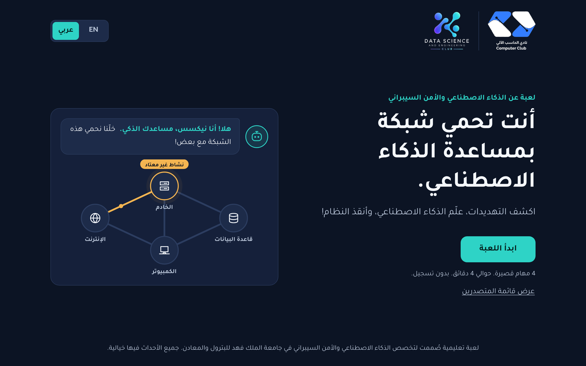
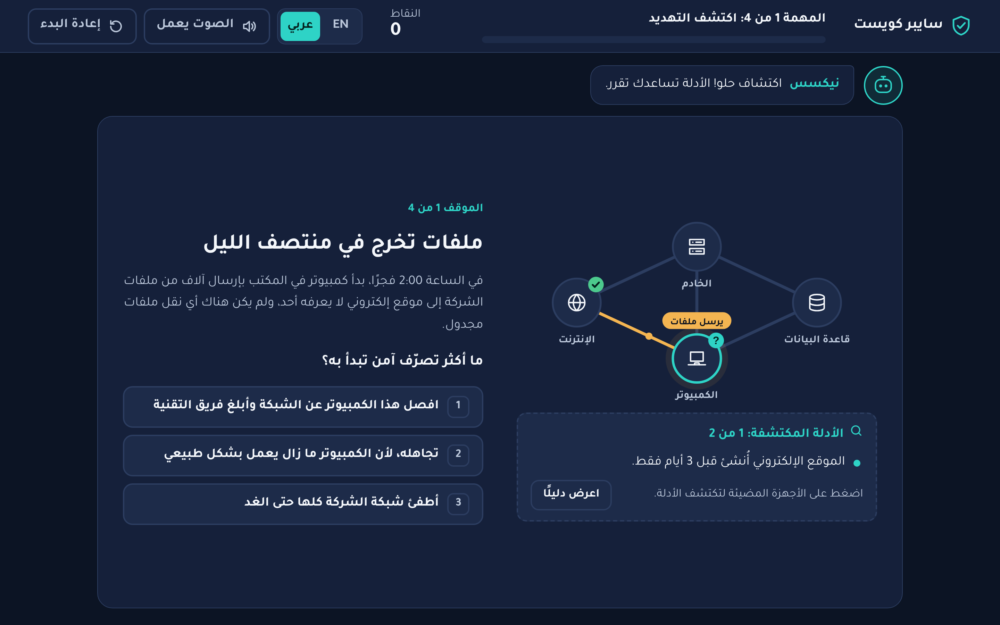
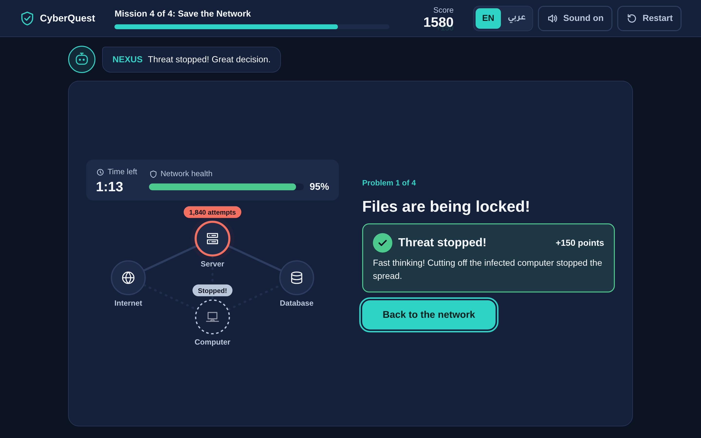

# CyberQuest

**A short, beginner-friendly game about AI and cybersecurity, in English and Arabic.** Players protect a network with the help of an AI assistant: they find clues, spot threats, teach an AI, decide when to trust it, and save the network from an attack. It takes about four minutes and needs no technical background.

**لعبة قصيرة وسهلة عن الذكاء الاصطناعي والأمن السيبراني، بالعربية والإنجليزية.**

CyberQuest was made as an exhibition game for the **Artificial Intelligence & Cybersecurity** major at King Fahd University of Petroleum & Minerals (KFUPM), together with the university's **Computer Club** and **Data Science and Engineering Club**. It is a student project and is not an official university product.


---

## Contents

1. [What players learn](#what-players-learn)
2. [Screenshots](#screenshots)
3. [How it plays](#how-it-plays)
4. [English and Arabic](#english-and-arabic)
5. [Club logos](#club-logos)
6. [How the AI works](#how-the-ai-works)
7. [Technology and structure](#technology-and-structure)
8. [Running it](#running-it)
9. [Deploying to GitHub Pages](#deploying-to-github-pages)
10. [Scoring](#scoring)
11. [Leaderboard limitations](#leaderboard-limitations)
12. [Testing](#testing)
13. [Future improvements](#future-improvements)

---

## What players learn

- Cybersecurity protects computers, accounts and information.
- AI can help spot unusual activity.
- AI learns from examples, and bad examples teach it bad lessons.
- AI makes mistakes: sometimes a false alarm, sometimes a missed attack.
- People and AI make better security decisions together.

## Screenshots

These are real captures of the game, taken during a scripted test run.

| Start screen | البداية بالعربية |
| --- | --- |
|  |  |

| Mission 1 in Arabic (right-to-left) | Mission 2: the trained AI's answers |
| --- | --- |
|  |  |

| Mission 3: do you agree with NEXUS? | Mission 4: stopping a threat |
| --- | --- |
|  |  |


## How it plays

Every decision uses the same clear structure:

- **Situation:** what is happening, in plain words.
- **Clues:** found by clicking the glowing devices in the network picture or the glowing parts of an email. A "Show a clue" button does the same for players who prefer it.
- **Question:** exactly what to decide, for example "What is the safest first action?"
- **Choices:** two or three specific actions.
- **Feedback:** a short explanation of why that choice was right or wrong, with its own text for every choice.

| | Mission | What the player does |
| --- | --- | --- |
| 1 | **Spot the Threat** | Four situations: files leaving at night, a phishing email, an IT security check, and an approved website update. Two are safe, which shows that unusual does not always mean dangerous. After deciding, every clue is revealed and the network picture shows the result. |
| 2 | **Teach the AI** | Drag eight example cards into a **Safe** or **Suspicious** box (or press the buttons, or keys 1 and 2). Press **Train the AI** and watch it learn, then watch it sort six new examples into the boxes. The game explains each mistake by pointing to the example the player sorted differently. |
| 3 | **Can You Trust the AI?** | NEXUS suggests an action and says how sure it is. The player clicks devices to find clues NEXUS cannot see, then answers *Yes, follow NEXUS* or *No, do this instead*. NEXUS is wrong in two of the four cases. |
| 4 | **Save the Network** | Problems flash on devices while a 75-second clock runs and network health drains. Click a flashing device (or its button) to open the problem, read the clue, and choose one of three actions. Stopped threats turn green with a "Stopped!" burst. One problem is just an employee who forgot their password, because not everything is an attack. |

**NEXUS**, the AI helper, appears as a friendly guide above the game. Its messages stay short, and it offers a hint if a player seems stuck for 20 seconds.

## English and Arabic

- An **EN / عربي** switch is on the start screen and in the game header. English is the default; the choice is saved in the browser.
- Switching during a game redraws the current screen in the other language **without losing progress**: the mission, the clues found, the answers given and the score all stay.
- Everything is translated, including situations, choices, feedback, NEXUS messages, hints, results, the score breakdown, the leaderboard and dialogs. The Arabic uses simple Modern Standard Arabic, with NEXUS speaking in a friendly Saudi tone.
- Arabic uses a full right-to-left layout (`dir="rtl"`). Progress bars fill from the right, and panels, icons and buttons mirror correctly.
- Arabic text uses the **Tajawal** font, self-hosted in `assets/fonts` so it works offline. English uses Arial.
- All interface text lives in `js/i18n.js` and all scenario text in `js/scenarios.js`, with each English text next to its Arabic translation. Tests fail if any text is missing a language.

## Club logos

The two club logos replace the CyberQuest logo at the top of the start screen. Once a player starts the game, the CyberQuest logo returns in the game header.

| File | Club |
| --- | --- |
| `assets/logos/club-1.png` | Computer Club (نادي الحاسب الآلي) |
| `assets/logos/club-2.png` | Data Science and Engineering Club |

- The displayed files have **transparent backgrounds**. Because the game screen is dark navy, the logos' black and dark-navy lettering was changed to white so it stays readable. All blue and gradient artwork keeps its original colours. Empty margins were trimmed.
- The untouched originals, with their white backgrounds, are kept in `assets/logos/original/`.
- To replace a logo, overwrite the PNG with the same name. Transparent PNG works best on the dark background. An SVG named `club-1.svg` or `club-2.svg` is also picked up if the PNG is missing.
- A logo file that fails to load is removed, never shown broken. If neither loads, the CyberQuest logo is shown instead.
- Alt text is translated: "Computer Club logo" / «شعار نادي الحاسب الآلي», and "Data Science and Engineering Club logo" / «شعار نادي علوم وهندسة البيانات». If the Data Science club has an official Arabic name, update `partners.club2` in `js/i18n.js`.

## How the AI works

CyberQuest has two kinds of AI, and the game says which is which.

### NEXUS: a simulated, rule-based assistant

NEXUS is **not** a language model and is not connected to anything. It is a set of about twenty hand-written rules in `js/ai-engine.js`. Each situation has hidden *telemetry*, such as wrong-password counts, how much data is moving compared with normal, whether it is night, and whether a website is known. Each rule that fires adds or subtracts points, giving a 0–100 score that becomes a suggestion and a "How sure?" level.

NEXUS only sees telemetry, never the clues the player finds (calendars, approvals, HR records). That is the realistic reason it gets some cases wrong:

- it wants to block the approved monthly backup (a false alarm),
- it trusts a login that an attacker tricked the employee into approving (a missed threat),
- it treats files leaking to a famous cloud website as normal (a missed threat).

These mistakes come out of the rules themselves, and the tests check that they happen.

### The trainable AI: a real k-nearest-neighbours classifier

Mission 2 uses genuine machine learning in plain JavaScript:

- Each example is described by five numbers: wrong passwords, unusual time, risky website, amount of data and new device.
- The model learns **only from how the player sorts the cards**. The correct answers are used afterwards to explain the result, never for training.
- It uses *k*-nearest neighbours with *k* = 3: a new example gets the label most common among the three most similar examples the player sorted.
- It is tested on six separate examples that are never used for training. "Very sure" means all three neighbours agreed; "Not sure" means they split 2 to 1.

Correct sorting gives 6 out of 6. Sorting everything as Safe drops it to 3 out of 6.

## Technology and structure

HTML, CSS and plain JavaScript. **No frameworks, build step, backend, API keys or external requests.** It runs as static files and also works when `index.html` is opened directly from disk.

```text
CyberQuest/
├── index.html              Start, play and results screens
├── css/
│   ├── style.css           Colours, fonts (incl. Arabic), type sizes, screen layouts
│   ├── components.css      Buttons, choices, clues, network picture, drag-and-drop, logos, results
│   └── animations.css      Small motion cues, reduced-motion support
├── js/
│   ├── i18n.js             English/Arabic interface text, language switching, RTL
│   ├── scenarios.js        All situations, clues, choices and feedback, in both languages
│   ├── ai-engine.js        NEXUS rules and the k-nearest-neighbours classifier
│   ├── game.js             Game state, scoring ledger, ranks, timers (no DOM)
│   ├── leaderboard.js      Local leaderboard with a swappable storage adapter
│   ├── audio.js            Short sound effects made with the Web Audio API
│   ├── network.js          The clickable four-device network picture
│   ├── ui.js               Safe DOM helpers, header, NEXUS bubble, feedback, dialogs
│   ├── missions.js         The four missions (state + render, so language can switch any time)
│   ├── results.js          Results, leaderboard and "What you learned"
│   └── app.js              Screen flow, language switching, restart, hints, idle reset, logos
├── assets/
│   ├── logos/              club-1.png, club-2.png (+ originals/)
│   ├── fonts/              Tajawal (Arabic), SIL Open Font License
│   └── icons/favicon.svg
├── docs/screenshots/
├── tests/logic.test.js     Tests for translations, AI, scoring and leaderboard
└── LICENSE
```

## Running it

Double-click `index.html`, or serve the folder:

```bash
python3 -m http.server 8000
```

Then open <http://localhost:8000> on the same computer. At the booth, use a full-screen browser window (F11). After two minutes without input the game asks "Still playing?" and returns to the start screen if nobody answers.

**Controls:** mouse or touch everywhere, including dragging cards in Mission 2. On a keyboard, `1`, `2` and `3` choose an answer, `C` shows a clue, `Tab` and `Enter` reach and press devices and buttons, and `Esc` closes a dialog.

## Deploying to GitHub Pages

1. Merge the work into `main`.
2. Open **Settings → Pages**, choose **Deploy from a branch**, pick `main` and `/ (root)`, and save.
3. The game appears at `https://<user>.github.io/<repository>/` after a minute or two.

All paths are relative, and the repository includes `.nojekyll`.

## Scoring

Every point comes from a decision, and the results screen can show the full breakdown in either language. Nothing is random.

| Where | Points |
| --- | --- |
| Mission 1: best / okay / wrong action | +100 / +40 / −30 to −80 |
| Mission 2: each card sorted like an expert / each new example the AI gets right | +15 / +25 |
| Mission 3: following NEXUS when it is right / disagreeing when it is wrong / a wrong call | +100 / +150 / −40 to −80 |
| Mission 4: best / okay / wrong action | +150 / +60 / −80 |
| Mission 4: unhandled threat when time runs out | −60 |
| Mission 4: seconds left / final network health | +2 per second / +2 per % |
| Each mission completed | +50 |
| Missions 1–3 finished within their target time | up to +50 |

Wrong choices also cost network health (real threats left running) or disrupt the business (blocking safe work). Ranks: **Cyber Recruit** (below 700), **Threat Hunter** (700+), **Security Analyst** (1,200+), **Cyber Defender** (1,700+), **Elite AI Guardian** (2,150+).

## Leaderboard limitations

- Scores are saved in the browser on the computer where the game was played. They do not sync between computers.
- Each game is saved once, under an anonymous name; players can add their own name on the results screen.
- Scores can be edited with browser developer tools, so they are not tamper-proof.
- `js/leaderboard.js` uses a small storage adapter, so a shared online leaderboard could be added later.

## Testing

```bash
node tests/logic.test.js
```

These tests check that every text exists in both languages with matching placeholders, that no English hides inside the Arabic, the NEXUS rules (including its intended mistakes), the classifier, scoring, ranks, name cleaning, timers and the leaderboard.

During development, the full game was also played automatically in headless Chromium, in English and in Arabic, at 1366×768, 1920×1080 and 375×812. Those runs:

- switched language mid-mission and checked that progress was kept,
- dragged cards with the mouse,
- scanned every visible text in Arabic mode for leftover English,
- checked for script errors, horizontal overflow, and gameplay screens that need scrolling at desktop sizes,
- covered right and wrong answers, a network breach, restart, the idle reset, missing logo files and opening the game from a file.

## Future improvements

- More situation packs and a shuffled order for replays.
- A staff settings screen (session length, idle time, leaderboard reset PIN).
- An optional shared leaderboard.

## License

MIT (see `LICENSE`). The Tajawal font is licensed under the SIL Open Font License 1.1. The club logos belong to their respective clubs.
